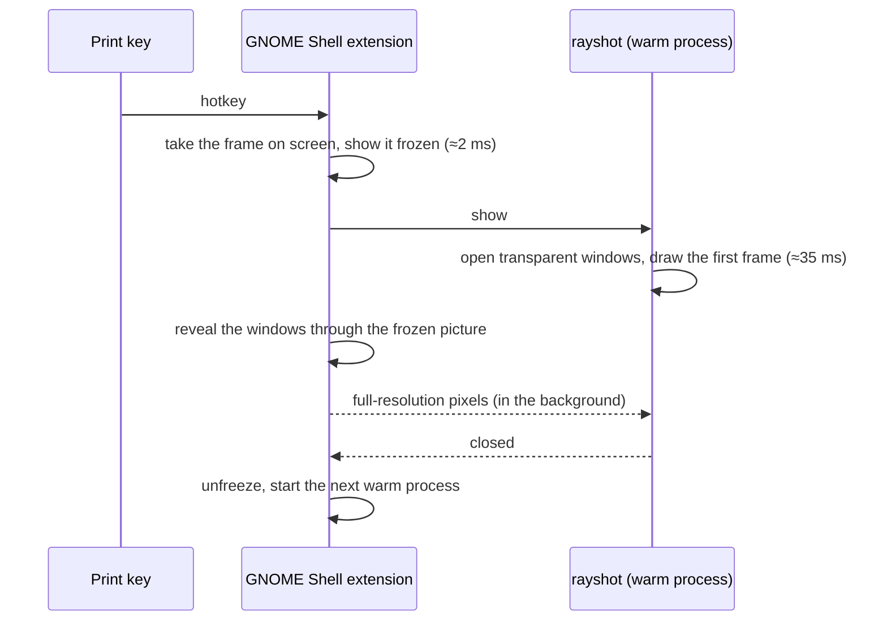

<div align="center">

# rayshot

**Lightshot-style screenshots for GNOME on Wayland.**<br>
Press the key, the screen freezes at once, drag a region, mark it up, press Enter.

[](https://aur.archlinux.org/packages/rayshot)
[](https://github.com/paranoica/rayshot/actions/workflows/ci.yml)
[](#supported-systems)
[](LICENSE)

**English** · [Русский](README.ru.md)

</div>

rayshot is a small screenshot and annotation tool written in Rust. On GNOME a
shell extension freezes the screen on the frame you pressed the key on, so
menus, tooltips and video frames are captured exactly as they were, and the
editor opens on top of that frozen picture in about 40 ms. No portal dialog,
no flash, no screen-sharing prompt.

- **Instant:** the screen freezes in about 2 ms and the editor follows right after.
- **What you see is what you get:** the picture is the frame on screen at the keypress.
- **Lightshot flow:** select, annotate, Enter copies, the floppy saves.
- **Tools:** pen, line, arrow, rectangle, marker, text, pixelate and a real blur.
- **Multi-monitor:** select across monitors; the last selection is remembered.

<div align="center">

</div>

## Contents

- [Install](#install)
- [Supported systems](#supported-systems)
- [Speed and resources](#speed-and-resources)
- [How it works](#how-it-works)
- [rayshot compared](#rayshot-compared)
- [How it is tested](#how-it-is-tested)
- [Usage](#usage)
- [Troubleshooting](#troubleshooting)
- [Ideas for later](#ideas-for-later)

## Install

### Arch Linux (AUR)

```sh
paru -S rayshot        # or rayshot-git for the latest commit
```

The package installs the binary and the GNOME extension. GNOME on Wayland
only loads new extensions at login, so log out and back in, then once:

```sh
rayshot install-hotkey Print
```

### Any other distribution

Take the archive from the [releases page](https://github.com/paranoica/rayshot/releases).
The binary (x86_64) is built on Debian 12, so it runs on anything with glibc
2.36 or newer. Unpack it somewhere permanent, then:

```sh
gnome-extension/install.sh      # copies the extension to ~/.local/share
# log out and back in
./rayshot install-hotkey Print
```

At runtime rayshot needs `wl-clipboard` and a Vulkan driver, plus
`xdg-desktop-portal` for the portal mode on other desktops.

### From source

```sh
cargo build --release
gnome-extension/install.sh
# log out and back in
./target/release/rayshot install-hotkey Print
```

A copy of the extension in `~/.local/share` wins over the packaged one, so run
`gnome-extension/uninstall.sh` before switching to the package.

## Supported systems

rayshot is built for **GNOME Shell 45 to 51 on Wayland**, and every one of
those versions is tested in CI. GNOME 45 is the floor because
that is where GNOME moved extensions to ES modules.

| Distribution | GNOME | Status |
|---|---|---|
| Arch Linux and other rolling GNOME distributions | 51 | tested in CI and on real hardware |
| Ubuntu 26.04 LTS | 50 | tested in CI |
| Fedora 43 | 49 | tested in CI |
| Debian 13 | 48 | tested in CI |
| Fedora 41 | 47 | tested in CI |
| Ubuntu 24.04 LTS | 46 | tested in CI |
| Fedora 39 | 45 | tested in CI |
| Fedora 40, 42, 44 · Ubuntu 25.04, 25.10 · openSUSE Tumbleweed | 45–51 | same GNOME versions, expected to work |
| Debian 12, Ubuntu 22.04, RHEL 9 and older | 44 or older | the extension does not load; only the portal mode |

**Other desktops** (KDE Plasma, Sway, Hyprland, Cinnamon, …) have no
extension. You can bind a key to `rayshot`, and it will capture through the
screenshot portal (the desktop needs a portal backend that can take
screenshots), without the freeze and with the portal's delay. This path
is best effort and is not tested.

**GPUs:** real hardware testing is on NVIDIA with the proprietary driver. CI
renders with Mesa in software, which shares Mesa's Wayland and Vulkan plumbing
with Intel and AMD but not their hardware drivers; real Intel and AMD cards are
not tested yet.

## Speed and resources

Measured on a GTX 1060 (driver 580), GNOME 51 and two 1080p monitors, over 100
captures with the warm editor and 20 without it. Times start when GNOME hands
rayshot the hotkey.

| | median | 90th percentile |
|---|---|---|
| Screen frozen | **1.7 ms** | 3.8 ms |
| Editor on screen (default, warm) | **38 ms** | 65 ms |
| Editor on screen (`rayshot warm off`) | 144 ms | 184 ms |
| Full-resolution pixels reach the editor | 870 ms | 1.0 s |

The last row happens in the background: you can select and draw as soon as
the editor is up, and only copying or saving waits for it if you are very fast.

| While idle | |
|---|---|
| CPU | about 0.2 % of one core |
| Memory | 146 MB resident, of which 24 MB is rayshot's own; the rest is the GPU driver's shared libraries |
| Video memory | 196 MB (NVIDIA) |
| Turned off | `rayshot warm off` frees all of it; captures then take the 144 ms path |

If the GPU driver crashes while the editor opens, which the NVIDIA driver does
about once in a few hundred captures, a fresh editor replaces it in about
0.1 s and the capture is not lost.

## How it works



- **The freeze lives in GNOME Shell.** The extension asks the compositor for
  the frame it is showing (`screenshot_stage_to_content`, the call GNOME's own
  screenshot UI uses) and lays it over everything. Keys and early clicks land
  on the freeze, so nothing leaks into the apps below, and a drag that starts
  before the editor is up becomes the selection.
- **The editor is a warm process.** One `rayshot serve` waits with its GPU
  device ready. Its windows are transparent and are revealed through the
  frozen picture only after their first frame, so there is no flash and no
  half-drawn window. Each process serves one capture and exits; the next one
  starts right away.
- **Every failure has a fallback.** If the warm process is missing, crashes or keeps
  failing, the extension starts a fresh rayshot for that capture. If copying
  fails, a notice says where the temporary copy is.

### What changed from 0.1

| | 0.1 (daemon) | 0.2 (extension) |
|---|---|---|
| Capture | a PipeWire screen-cast stream kept open by a daemon | the compositor's own frame, taken at the keypress |
| Delay before you can select | near-instant with the daemon; about 400 ms and a flash without it | about 40 ms, no flash |
| Picture after the monitors slept | could be stale until the daemon was restarted | always the current frame |
| Idle cost | about 90 MB and a few % CPU while the screen changed | 0.2 % CPU, 24 MB of its own |
| Hotkey | a custom GNOME shortcut that started a process | handled inside GNOME Shell |
| Keys pressed during the capture | could reach the app below | held by the freeze |

## rayshot compared

rayshot is about one thing: the Lightshot flow (key, frozen screen, drag,
draw, Enter) at native speed on GNOME Wayland. Other tools do more in other
directions, and the tables say where.

### On Linux

| | rayshot | GNOME screenshot UI | Flameshot | Ksnip | Spectacle | Gradia | Satty / Swappy |
|---|---|---|---|---|---|---|---|
| GNOME Wayland | yes | yes | experimental | yes, with limits | not documented | yes, through the portal | no, wlroots only |
| Still picture to select on | at the keypress, ≈2 ms | at the keypress | after a portal call | after a portal call | not documented on GNOME | GNOME's own UI | n/a |
| Arrows, text, shapes | yes | no | yes | yes | yes | yes | yes |
| Blur / pixelate | both | no | pixelate | yes | yes | censor tool | Satty both, Swappy blur |
| Upload, OCR | no | no | Imgur | Imgur, OCR plugin | OCR | upload, OCR | no |
| Key to selection | ≈40 ms, measured | freezes at once, not measured | long delays reported on GNOME | not found | 1.5–2 s reported | not found | n/a |
| Memory | 24 MB own, 146 MB resident | part of the shell | 36 MB on a Raspberry Pi | not found | 67 MB on a Raspberry Pi | not found | not found |

<details>
<summary>Notes and sources</summary>

- **GNOME screenshot UI** freezes the screen with the same compositor call rayshot uses (GNOME Shell's `screenshot.js`), but it only crops; there is nothing to draw with.
- **Flameshot:** GNOME Wayland support is labelled experimental; it captures through the portal, and its capture window has to stay open for the clipboard ([README](https://github.com/flameshot-org/flameshot), [v14 notes](https://github.com/flameshot-org/flameshot/releases)). Users report a permission dialog and long delays on GNOME ([NixOS forum](https://discourse.nixos.org/t/looking-for-a-gnome-compatible-screenshot-annotation-tool/75964)); the Arch Wiki notes slow area selection in some versions ([wiki](https://wiki.archlinux.org/title/Flameshot)).
- **Ksnip:** global hotkeys do not work on Wayland, and the clipboard may need `QT_QPA_PLATFORM=xcb` on GNOME; one maintainer ([README](https://github.com/ksnip/ksnip)).
- **Spectacle:** KDE's tool; users report 1.5–2 s from PrtSc to the window ([KDE forum](https://discuss.kde.org/t/make-spectacle-launch-faster/38030)).
- **Shutter:** in maintenance mode with rudimentary Wayland support ([FAQ](https://shutter-project.org/faq-help/)).
- **Gradia:** a GTK4 app to beautify and redact screenshots, with OCR and upload ([repo](https://github.com/AlexanderVanhee/Gradia)).
- **Satty / Swappy:** annotators for `grim` output on wlroots compositors ([Satty](https://github.com/Satty-org/Satty), [Swappy](https://github.com/jtheoof/swappy)).
- The Flameshot and Spectacle memory figures come from a Raspberry Pi 4 test ([LinuxLinks](https://www.linuxlinks.com/raspberry-pi-4-chronicling-desktop-experience-screen-capture/)). No controlled benchmark of these tools has been published; "not found" means exactly that.

</details>

### Against the Windows and macOS classics

| | rayshot | Lightshot | ShareX | Snipping Tool | macOS ⇧⌘4 | CleanShot X | Shottr |
|---|---|---|---|---|---|---|---|
| Platform | Linux (GNOME) | Windows, macOS | Windows | Windows | macOS | macOS | macOS |
| Price | free, MIT | free | free, GPL | built in | built in | $35 | pay what you want |
| Freezes at the keypress | yes | not documented | not documented | dims the screen | not documented | not documented | optional |
| Draw before copying | yes | yes | yes | afterwards, in a window | in a thumbnail editor | yes | yes |
| Blur / pixelate | both | no | both | redact | no | redact | not found |
| Upload | never | public prnt.sc links | many services | no | no | cloud | S3 |
| OCR, scrolling capture | no | no | yes | OCR | no | yes | yes |
| Published speed | ≈40 ms, measured | not found | not found | not found | not found | not found | 17 ms to grab, 165 ms to show (vendor) |

<details>
<summary>Notes and sources</summary>

- **Lightshot** is where this flow comes from. Its uploads are public: anyone who guesses a `prnt.sc` link can open the image ([privacy policy](https://lightshot.app/en/privacy.html)). rayshot never uploads anything.
- **ShareX** is the most complete free tool on Windows: annotations, many upload targets, OCR, scrolling capture ([site](https://getsharex.com/), [region capture](https://getsharex.com/docs/region-capture)).
- **Snipping Tool** greys the screen, then opens the shot in a separate editor; OCR runs on the device ([Microsoft](https://support.microsoft.com/en-us/windows/use-snipping-tool-to-capture-screenshots-00246869-1843-655f-f220-97299b865f6b)).
- **macOS** edits through the thumbnail in the corner; holding Control copies to the clipboard ([Apple](https://support.apple.com/en-us/102646)).
- **CleanShot X:** $35 with a year of updates, on-device OCR, scrolling capture, cloud sharing ([pricing](https://cleanshot.com/pricing), [features](https://cleanshot.com/)).
- **Shottr** can freeze the screen for area capture since 1.9 and states 17 ms to grab and about 165 ms to show ([site](https://shottr.cc/), [freezing capture](https://shottr.cc/kb/customareacapture)).
- **Greenshot** (Windows free, macOS $1.99) and **Snagit** (subscription) are popular too; their freeze behaviour and speed are not documented ([Greenshot](https://getgreenshot.org/downloads/), [Snagit](https://www.techsmith.com/store/snagit)).

</details>

**What rayshot does not do:** no upload, no OCR, no scrolling or window
capture, no screen recording, and the fast path is GNOME only.

## How it is tested

- **Unit tests:** 68 in Rust and 5 suites for the extension (geometry, frame
  format, respawn backoff, GNOME version shims, the memory metric).
- **Soak test:** a headless GNOME Shell, a real rayshot and a driver extension
  run 100 warm and 20 cold captures and then 15 scenarios, and fail on a leak
  in the editor process, in video memory or in GNOME Shell itself. The
  scenarios include:
  - Enter copies a PNG on both paths; a `wl-copy` that hangs closes the editor and leaves a notice
  - an app taking the focus from the open editor; a key held through a cancelled capture
  - the warm process crashing while it opens its windows (replaced in under 300 ms) or failing again and again (it stops, says so, recovers)
  - a monitor unplugged and plugged back while the warm process waits, screens going to sleep, lock and unlock
  - every capture showing the screen as it is right now
- **CI:** every push to `main` and every pull request runs the unit tests,
  then a shorter soak (20 warm and 5 cold captures, then all the scenarios)
  in containers for GNOME 45, 46, 47, 48, 49, 50 and 51: Fedora 39,
  Ubuntu 24.04, Fedora 41, Debian 13, Fedora 43, Ubuntu 26.04 and Arch,
  rendering in software.
- **Real hardware:** the full soak on an NVIDIA card.
- **The tests are tested:** each scenario was run against a deliberately
  broken build (a stale picture, a stale monitor list, no restart after an
  unlock, …) to prove it fails when it should.

Run it yourself:

```sh
gnome-extension/tests/soak.sh 100 20                                      # on this machine
gnome-extension/tests/containers/run.sh debian-13 target/release/rayshot  # in a container
```

## Usage

Press the hotkey, drag a region, annotate, press Enter.

| Key | Tool | | Key | Action |
|---|---|---|---|---|
| `S` / `V` | select, move, resize | | `Enter` / `Ctrl+C` | copy |
| `P` | pen | | floppy button | save to your pictures folder |
| `L` | line | | `Ctrl+Z` | undo |
| `A` | arrow | | `Ctrl+Y` / `Ctrl+Shift+Z` | redo |
| `R` | rectangle | | `Esc` | cancel |
| `M` | marker | | | |
| `T` | text | | | |
| `X` | pixelate | | | |
| `B` | blur | | | |

Hold **Shift** while drawing for straight work, as in Paint: lines, arrows,
the pen and the marker snap to 45° steps, and rectangles become squares.

**Where screenshots go.** Copying puts the image on the clipboard and keeps a
temporary copy in `$XDG_RUNTIME_DIR/rayshot/`, which lives in RAM, is cleared
at logout and pruned after 24 hours. Saving writes
`rayshot-DD-MM-YYYY-HH-MM-SS.png` to the pictures folder from your desktop
settings (`XDG_PICTURES_DIR`, such as `~/Pictures` or its translated name),
creating it if it is missing inside your home. If that folder cannot be used,
the file goes to `~/Pictures` if it exists, and only as a last resort to `/tmp`.

<details>
<summary>Commands and environment variables</summary>

| Command | |
|---|---|
| `rayshot install-hotkey [binding]` | GNOME: set the hotkey (`Print` by default); until then the extension listens on `Ctrl+Print` |
| `rayshot uninstall-hotkey` | GNOME: disable the extension and give `Print` back to GNOME |
| `rayshot warm [on\|off\|status]` | keep the warm editor process, or not |
| `rayshot` | portal mode: capture through the screenshot portal |
| `rayshot shot [path]` | capture the whole desktop to a PNG through the portal |
| `rayshot monitors` | list the detected monitors |

`rayshot serve` and `rayshot overlay --live` are started by the extension.

| Variable | |
|---|---|
| `RAYSHOT_NO_REMEMBER_SELECTION` | start every capture without the previous selection |
| `RAYSHOT_KEEP_ANIMATIONS` | portal mode: leave GNOME's animations on |
| `RAYSHOT_BIN` | for the extension: absolute path of the rayshot binary, set in GNOME Shell's environment |

</details>

## Troubleshooting

| Symptom | Fix |
|---|---|
| The hotkey does nothing after an install or update | GNOME on Wayland cannot reload extensions: log out and back in. `gnome-extensions info rayshot@paranoica` shows the state. |
| `Print` still opens GNOME's own screenshot UI | run `rayshot install-hotkey Print` once. |
| "rayshot keeps failing to prepare its overlay" | the warm process failed five times in a row, so captures take the slower path. Look at `journalctl --user -b \| grep rayshot`, then run `rayshot warm off` and `rayshot warm on`. |
| The screen freezes but no editor appears | the GPU may be out of video memory; a screen recorder with a replay buffer is a common cause. Check `nvidia-smi` or your driver's tool. |
| The clipboard is empty after Enter | `wl-copy` did not get the focus in time; a notice says where the temporary copy is. |
| `Print` does nothing after removing the package | `gsettings reset org.gnome.shell.keybindings show-screenshot-ui` |
| "rayshot was updated. Log out and back in…" | the package was upgraded while the old extension is still loaded: log out and back in. |
| "rayshot was updated. Run rayshot install-hotkey Print…" | you came from the 0.1 daemon: run `rayshot install-hotkey Print` once. |
| "rayshot and its GNOME extension do not match" or "…is older than its GNOME extension" | update rayshot, then log out and back in, so the program and the extension come from the same release. |
| "The rayshot program was not found" | install rayshot, or point the extension at it with `RAYSHOT_BIN` or `gnome-extension/install.sh`. |

## License

MIT. See [LICENSE](LICENSE).
