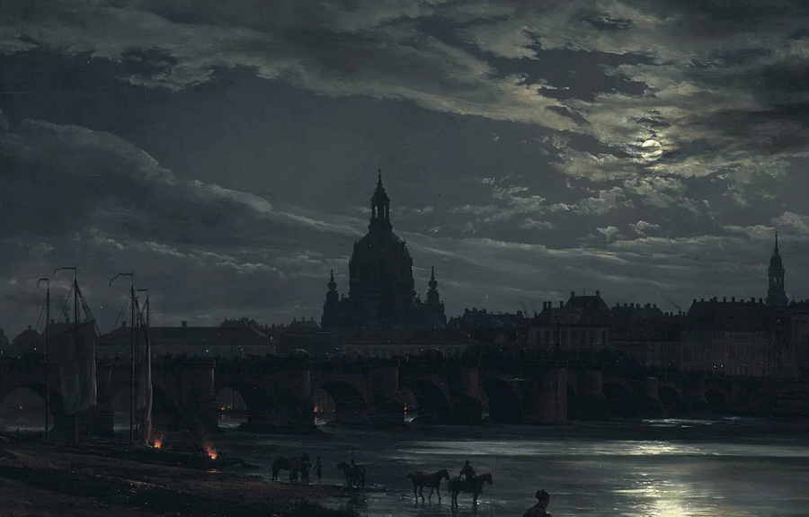

# rayshot

[](https://aur.archlinux.org/packages/rayshot)
[](https://github.com/paranoica/rayshot/actions/workflows/ci.yml)
[](LICENSE)

A fast screenshot and annotation tool for Linux. Select a region, mark it up,
copy or save. Written in Rust, built for GNOME on Wayland, where a small
GNOME Shell extension freezes the screen the moment you press the key.



## Features

- The screen freezes on the frame you pressed the key on: no portal, no flash,
  no screen-sharing prompt.
- Region select across multiple monitors, with the last selection remembered.
- Annotation tools: pen, line, arrow, rectangle, marker (highlighter), text.
- Two ways to hide things: **pixelate** (mosaic brush) and a real **blur** brush.
- Colour picker (red by default), undo/redo, move and resize of the selection.
- Copy to the clipboard, or save to `~/Pictures`.

## How it works

rayshot has two parts:

- **The GNOME Shell extension** (`rayshot@paranoica`) owns the hotkey. When you
  press it, the extension copies the shell's own picture of the screen and
  shows it as a frozen layer on top of everything, so what you see stops
  moving at once. Keys and early clicks are held back so nothing leaks into
  the apps underneath.
- **The rayshot program** draws the editor. The extension keeps one rayshot
  process ready in the background (the *spare*) with the GPU already set up,
  hands it the frozen pixels, and shows its windows through the frozen layer
  once they have drawn their first frame. Each spare serves one capture and
  exits; the extension starts the next one right away.

If the spare is turned off or keeps failing, the extension starts a fresh
rayshot per capture instead. The freeze is just as fast, the editor takes a
little longer to appear.

The spare costs memory while idle: about 190 MB resident on an NVIDIA
machine. Turn it off with `rayshot warm off` if you would rather save that.

## Desktop support

| Desktop                 | Status |
|-------------------------|--------|
| **GNOME 45–51 (Wayland)** | Full support through the extension: instant freeze, hotkey setup. Every version is tested in CI with software rendering. |
| **Older GNOME** | The extension does not load there. Bind a key to `rayshot` by hand for the portal mode below. |
| **KDE / other Wayland** | Portal mode: `rayshot` captures through the screenshot portal (about 400 ms and a flash per shot). Bind the key by hand. |
| **wlroots (Sway/Hyprland)** | Not supported: the portal screenshot backend is usually missing. |
| **X11**                 | Not supported. |

## Install

### Arch Linux (AUR)

```sh
paru -S rayshot        # or rayshot-git for the latest commit
```

The package puts the extension in `/usr/share/gnome-shell/extensions`. GNOME
on Wayland only loads new extensions at login, so log out and back in, then
run as your user:

```sh
rayshot install-hotkey Print
```

### From source

Runtime needs: `wl-clipboard`, a Vulkan driver, and `xdg-desktop-portal` with
a backend for portal mode. Building needs a Rust toolchain.

```sh
cargo build --release
gnome-extension/install.sh
```

`install.sh` copies the extension to `~/.local/share/gnome-shell/extensions`
and points it at `target/release/rayshot`. Log out and back in, then run
`./target/release/rayshot install-hotkey Print`.

A copy in `~/.local/share` wins over the system one, so remove it with
`gnome-extension/uninstall.sh` before switching to the package.

### Release archive

The archive from the GitHub releases page has the binary and the extension.
Unpack it somewhere permanent and run `gnome-extension/install.sh` from it.
The extension will use the `rayshot` binary that sits next to that folder,
so after logging back in run `./rayshot install-hotkey Print` from there.

## The hotkey

Once enabled, the extension listens on `Ctrl+Print`. `rayshot install-hotkey
Print` enables it if needed, moves the hotkey to `Print` and takes `Print` away from GNOME's own screenshot
tool (the old binding is backed up). Any other binding works too:

```sh
rayshot install-hotkey '<Super><Shift>s'
```

`rayshot uninstall-hotkey` disables the extension and gives `Print` back to
GNOME. Run it before removing the package; if you forgot, restore `Print`
with:

```sh
gsettings reset org.gnome.shell.keybindings show-screenshot-ui
```

## Usage

Press the hotkey, drag to select a region, then annotate.

Tools (toolbar or keyboard):

| Key | Tool                         |
|-----|------------------------------|
| `S` / `V` | Select / move / resize |
| `P` | Pen                          |
| `L` | Line                         |
| `A` | Arrow                        |
| `R` | Rectangle                    |
| `M` | Marker (highlighter)         |
| `T` | Text                         |
| `X` | Pixelate (mosaic)            |
| `B` | Blur                         |

Actions:

| Key | Action                                  |
|-----|-----------------------------------------|
| `Ctrl+C` / `Enter` | Copy to the clipboard and keep a temporary copy |
| Toolbar floppy     | Save to `~/Pictures`             |
| `Ctrl+Z`           | Undo                             |
| `Ctrl+Y` / `Ctrl+Shift+Z` | Redo                      |
| `Esc`              | Cancel                           |

## Where screenshots go

- **Copy** (`Ctrl+C` / `Enter`): the image goes to the clipboard, and a copy
  is written to `$XDG_RUNTIME_DIR/rayshot/`. That folder lives in RAM, is
  cleared at logout, and files older than 24 hours are removed on the next
  capture. Treat it as a cache.
- **Save** (floppy button): a permanent file at
  `~/Pictures/rayshot-DD-MM-YYYY-HH-MM-SS.png`, or in `/tmp` if there is no
  `~/Pictures`.

## Commands

| Command | Description |
|---------|-------------|
| `rayshot` | Portal mode: capture through the screenshot portal and open the editor. |
| `rayshot install-hotkey [binding]` | GNOME: set the extension's hotkey (`Print` by default). |
| `rayshot uninstall-hotkey` | GNOME: disable the extension and restore `Print`. |
| `rayshot warm [on\|off\|status]` | GNOME: keep the spare editor process ready, or not. |
| `rayshot shot [path]` | Capture the whole desktop to a PNG through the portal and exit. |
| `rayshot monitors` | List the detected monitors. |

`rayshot serve` and `rayshot overlay --live` are started by the extension and
are not meant to be run by hand.

## Environment variables

| Variable | Effect |
|----------|--------|
| `RAYSHOT_NO_REMEMBER_SELECTION` | Start every capture without the previous selection. |
| `RAYSHOT_KEEP_ANIMATIONS` | Portal mode: leave GNOME animations on during a capture. |
| `RAYSHOT_BIN` | Read by the extension: absolute path of the rayshot binary to run. Must be set in GNOME Shell's environment. |

## Troubleshooting

- **The hotkey does nothing after an install or update.** GNOME on Wayland
  cannot reload an extension, so log out and back in. `gnome-extensions info
  rayshot@paranoica` shows whether it is enabled and running.
- **"rayshot keeps failing to prepare its overlay".** The spare crashed five
  times in a row, so captures now start a fresh rayshot each time. Check the
  log with `journalctl --user -b | grep rayshot`, then run `rayshot warm off`
  and `rayshot warm on` to try the spare again.
- **The hotkey works but no editor appears.** The GPU may be out of memory.
  A screen recorder with a replay buffer is a common cause; check
  `nvidia-smi` or your driver's equivalent.

## Ideas for later

- **Editor windows that already exist.** Keeping the spare's windows created
  but hidden would make the editor appear about 40 ms sooner. Hidden windows
  still show up in the panel, Alt+Tab and the dash, and can take the focus,
  so it is not worth it yet.

## License

MIT. See [LICENSE](LICENSE).
