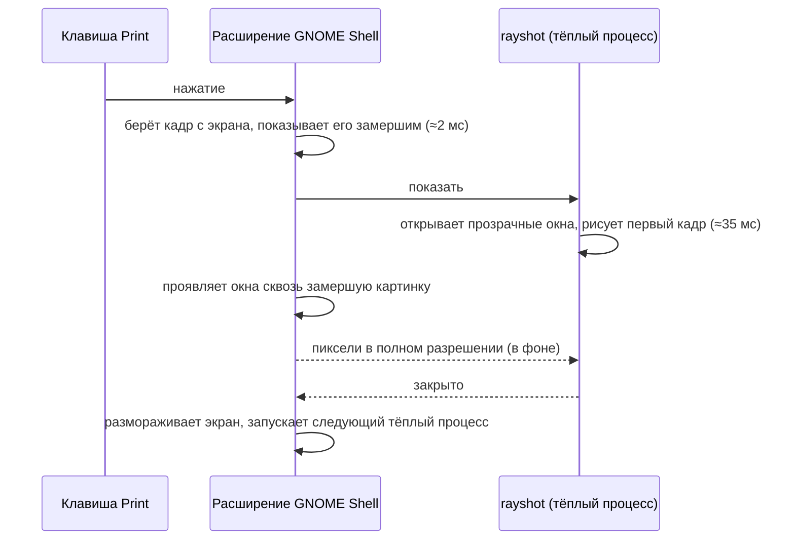

<div align="center">

# rayshot

**Скриншоты в духе Lightshot для GNOME на Wayland.**<br>
Нажмите клавишу — экран мгновенно замрёт, выделите область, добавьте пометки и нажмите Enter.

[](https://aur.archlinux.org/packages/rayshot)
[](https://github.com/paranoica/rayshot/actions/workflows/ci.yml)
[](#поддерживаемые-системы)
[](LICENSE)

[English](README.md) · **Русский**

</div>

rayshot — небольшая программа для скриншотов с пометками, написана на Rust. В
GNOME расширение шелла замораживает экран на том кадре, который был в момент
нажатия, поэтому меню, подсказки и кадры видео попадают в снимок ровно такими,
какими были. Редактор открывается поверх замороженной картинки примерно за
40 мс. Без окна портала, без вспышки, без вопроса о доступе к экрану.

- **Мгновенно:** экран замирает примерно за 2 мс, и редактор появляется сразу следом.
- **Что видишь, то и получаешь:** в снимке ровно тот кадр, что был на экране при нажатии.
- **Как в Lightshot:** выделить, разметить, Enter копирует, дискета сохраняет.
- **Инструменты:** карандаш, линия, стрелка, прямоугольник, маркер, текст, пикселизация и настоящее размытие.
- **Несколько мониторов:** выделение через несколько экранов, последнее выделение запоминается.

<div align="center">

</div>

## Содержание

- [Установка](#установка)
- [Поддерживаемые системы](#поддерживаемые-системы)
- [Скорость и ресурсы](#скорость-и-ресурсы)
- [Как это работает](#как-это-работает)
- [Сравнение с другими](#сравнение-с-другими)
- [Как это проверяется](#как-это-проверяется)
- [Использование](#использование)
- [Если что-то не так](#если-что-то-не-так)
- [Идеи на будущее](#идеи-на-будущее)

## Установка

### Arch Linux (AUR)

```sh
paru -S rayshot        # или rayshot-git для последнего коммита
```

Пакет ставит программу и расширение GNOME. GNOME на Wayland подхватывает новые
расширения только при входе, поэтому выйдите из сессии, войдите снова и один
раз выполните:

```sh
rayshot install-hotkey Print
```

### Любой другой дистрибутив

Скачайте архив со [страницы релизов](https://github.com/paranoica/rayshot/releases).
Программа (x86_64) собрана на Debian 12 и запускается везде, где glibc 2.36 или новее.
Распакуйте архив туда, где он будет лежать постоянно, и выполните:

```sh
gnome-extension/install.sh      # копирует расширение в ~/.local/share
# выйти из сессии и войти снова
./rayshot install-hotkey Print
```

Для работы нужны `wl-clipboard` и драйвер Vulkan, а для режима через портал на
других рабочих столах ещё `xdg-desktop-portal`.

### Из исходников

```sh
cargo build --release
gnome-extension/install.sh
# выйти из сессии и войти снова
./target/release/rayshot install-hotkey Print
```

Копия расширения в `~/.local/share` перекрывает установленную из пакета,
поэтому перед переходом на пакет выполните `gnome-extension/uninstall.sh`.

## Поддерживаемые системы

rayshot сделан под **GNOME Shell с 45 по 51 версию на Wayland**, и каждая из
этих версий проверяется в CI. Ниже 45 нельзя: с этой версии
расширения GNOME перешли на ES-модули.

| Дистрибутив | GNOME | Статус |
|---|---|---|
| Arch Linux и другие дистрибутивы с актуальным GNOME | 51 | проверен в CI и на реальном железе |
| Ubuntu 26.04 LTS | 50 | проверен в CI |
| Fedora 43 | 49 | проверен в CI |
| Debian 13 | 48 | проверен в CI |
| Fedora 41 | 47 | проверен в CI |
| Ubuntu 24.04 LTS | 46 | проверен в CI |
| Fedora 39 | 45 | проверен в CI |
| Fedora 40, 42, 44 · Ubuntu 25.04, 25.10 · openSUSE Tumbleweed | 45–51 | те же версии GNOME, должно работать |
| Debian 12, Ubuntu 22.04, RHEL 9 и более ранние | 44 и ниже | расширение не загрузится, работает только режим через портал |

**Другие рабочие столы** (KDE Plasma, Sway, Hyprland, Cinnamon и т. д.):
расширения там нет. Можно повесить `rayshot` на клавишу, и он снимет экран
через портал (нужен бэкенд портала, который умеет делать скриншоты), без
заморозки и с задержкой портала. Этот путь работает по возможности и не
тестируется.

**Видеокарты:** на реальном железе проверено на NVIDIA с проприетарным
драйвером. CI рисует программно через Mesa, у которой с Intel и AMD общая
обвязка Wayland и Vulkan, но не сами драйверы железа. Настоящие карты Intel и
AMD пока не проверялись.

## Скорость и ресурсы

Замерено на GTX 1060 (драйвер 580), GNOME 51, два монитора 1080p: 100 снимков
с тёплым редактором и 20 без него. Время считается с момента, когда GNOME
передаёт rayshot нажатие клавиши.

| | медиана | 90-й процентиль |
|---|---|---|
| Экран замер | **1.7 мс** | 3.8 мс |
| Редактор на экране (по умолчанию, тёплый) | **38 мс** | 65 мс |
| Редактор на экране (`rayshot warm off`) | 144 мс | 184 мс |
| Пиксели в полном разрешении дошли до редактора | 870 мс | 1.0 с |

Последняя строка идёт в фоне: выделять и рисовать можно сразу, как только
появился редактор. Ждать её придётся только копированию или сохранению, и то
если действовать очень быстро.

| В простое | |
|---|---|
| Процессор | около 0.2 % одного ядра |
| Память | 146 МБ в RSS, из них собственных у rayshot 24 МБ, остальное — общие библиотеки драйвера видеокарты |
| Видеопамять | 196 МБ (NVIDIA) |
| Если выключить | `rayshot warm off` освобождает всё это, снимки тогда идут по пути на 144 мс |

Если драйвер видеокарты падает в момент открытия редактора (у NVIDIA это
бывает примерно раз на несколько сотен снимков), новый редактор встаёт на его
место примерно за 0.1 с, и снимок не теряется.

## Как это работает



- **Заморозка живёт в GNOME Shell.** Расширение просит у композитора кадр,
  который он сейчас показывает (`screenshot_stage_to_content`, тот же вызов,
  что у встроенного скриншотера GNOME), и кладёт его поверх всего. Клавиши и
  ранние клики попадают в заморозку и не уходят в приложения под ней, а
  выделение, начатое до появления редактора, становится выделением в нём.
- **Редактор — тёплый процесс.** Один `rayshot serve` ждёт с уже готовым
  устройством GPU. Его окна прозрачные и проявляются сквозь замершую картинку
  только после первого кадра, поэтому нет ни вспышки, ни недорисованного окна.
  Каждый процесс обслуживает один снимок и выходит, следующий запускается сразу.
- **На любой сбой есть запасной путь.** Если тёплого процесса нет, он упал или падает
  раз за разом, расширение запускает для этого снимка новый rayshot. Если
  копирование не удалось, уведомление подскажет, где лежит временная копия.

### Чем 0.2 отличается от 0.1

| | 0.1 (демон) | 0.2 (расширение) |
|---|---|---|
| Снимок | поток PipeWire, который держал открытым демон | собственный кадр композитора в момент нажатия |
| Задержка до выделения | почти мгновенно с демоном, около 400 мс и вспышка без него | около 40 мс, без вспышки |
| Картинка после сна мониторов | могла быть устаревшей, пока не перезапустишь демон | всегда текущий кадр |
| Цена в простое | около 90 МБ и несколько % процессора, пока менялся экран | 0.2 % процессора, 24 МБ собственной памяти |
| Горячая клавиша | пользовательское сочетание GNOME, запускавшее процесс | обрабатывается внутри GNOME Shell |
| Клавиши во время снимка | могли уйти в приложение под ним | держит заморозка |

## Сравнение с другими

rayshot делает одну вещь: сценарий Lightshot (клавиша, замерший экран,
выделение, рисование, Enter) с родной скоростью в GNOME на Wayland. Другие
программы умеют больше в других направлениях, и таблицы это показывают.

### В Linux

| | rayshot | Скриншотер GNOME | Flameshot | Ksnip | Spectacle | Gradia | Satty / Swappy |
|---|---|---|---|---|---|---|---|
| GNOME на Wayland | да | да | экспериментально | да, с ограничениями | не описано | да, через портал | нет, только wlroots |
| Неподвижная картинка для выделения | в момент нажатия, ≈2 мс | в момент нажатия | после вызова портала | после вызова портала | не описано для GNOME | встроенный скриншотер GNOME | — |
| Стрелки, текст, фигуры | да | нет | да | да | да | да | да |
| Размытие / пикселизация | оба | нет | пикселизация | да | да | инструмент цензуры | Satty оба, Swappy размытие |
| Загрузка, OCR | нет | нет | Imgur | Imgur, OCR плагином | OCR | загрузка, OCR | нет |
| От клавиши до выделения | ≈40 мс, замерено | замирает сразу, не замерялось | в GNOME жалуются на долгие задержки | не найдено | 1.5–2 с по отзывам | не найдено | — |
| Память | 24 МБ своих, 146 МБ RSS | часть шелла | 36 МБ на Raspberry Pi | не найдено | 67 МБ на Raspberry Pi | не найдено | не найдено |

<details>
<summary>Подробности и источники</summary>

- **Скриншотер GNOME** замораживает экран тем же вызовом композитора, что и rayshot (`screenshot.js` в GNOME Shell), но умеет только обрезать: рисовать нечем.
- **Flameshot:** поддержка GNOME на Wayland помечена как экспериментальная, снимает через портал, а окно снимка должно оставаться открытым ради буфера обмена ([README](https://github.com/flameshot-org/flameshot), [заметки к v14](https://github.com/flameshot-org/flameshot/releases)). В GNOME жалуются на окно разрешения и долгие задержки ([форум NixOS](https://discourse.nixos.org/t/looking-for-a-gnome-compatible-screenshot-annotation-tool/75964)), а Arch Wiki отмечает медленное выделение в некоторых версиях ([wiki](https://wiki.archlinux.org/title/Flameshot)).
- **Ksnip:** глобальные горячие клавиши на Wayland не работают, в GNOME для буфера обмена может понадобиться `QT_QPA_PLATFORM=xcb`; у проекта один мейнтейнер ([README](https://github.com/ksnip/ksnip)).
- **Spectacle:** программа KDE; пользователи пишут о 1.5–2 с от PrtSc до окна ([форум KDE](https://discuss.kde.org/t/make-spectacle-launch-faster/38030)).
- **Shutter:** в режиме поддержки, Wayland поддерживается в зачаточном виде ([FAQ](https://shutter-project.org/faq-help/)).
- **Gradia:** приложение на GTK4, чтобы украшать и закрашивать скриншоты, с OCR и загрузкой ([репозиторий](https://github.com/AlexanderVanhee/Gradia)).
- **Satty / Swappy:** редакторы для снимков `grim` на композиторах wlroots ([Satty](https://github.com/Satty-org/Satty), [Swappy](https://github.com/jtheoof/swappy)).
- Цифры памяти Flameshot и Spectacle взяты из теста на Raspberry Pi 4 ([LinuxLinks](https://www.linuxlinks.com/raspberry-pi-4-chronicling-desktop-experience-screen-capture/)). Контролируемых бенчмарков этих программ никто не публиковал; «не найдено» значит ровно это.

</details>

### Против классики Windows и macOS

| | rayshot | Lightshot | ShareX | Ножницы | macOS ⇧⌘4 | CleanShot X | Shottr |
|---|---|---|---|---|---|---|---|
| Платформа | Linux (GNOME) | Windows, macOS | Windows | Windows | macOS | macOS | macOS |
| Цена | бесплатно, MIT | бесплатно | бесплатно, GPL | встроено | встроено | $35 | сколько заплатите |
| Замораживает экран при нажатии | да | не описано | не описано | затемняет экран | не описано | не описано | по желанию |
| Рисовать до копирования | да | да | да | потом, в отдельном окне | в редакторе миниатюры | да | да |
| Размытие / пикселизация | оба | нет | оба | скрытие данных | нет | скрытие данных | не найдено |
| Загрузка | никогда | публичные ссылки prnt.sc | много сервисов | нет | нет | облако | S3 |
| OCR, длинные снимки с прокруткой | нет | нет | да | OCR | нет | да | да |
| Опубликованная скорость | ≈40 мс, замерено | не найдено | не найдено | не найдено | не найдено | не найдено | 17 мс снимок, 165 мс до показа (по словам автора) |

<details>
<summary>Подробности и источники</summary>

- **Lightshot** — оттуда и пришёл этот сценарий. Загруженные в нём картинки публичные: любой, кто угадает ссылку `prnt.sc`, их увидит ([политика конфиденциальности](https://lightshot.app/en/privacy.html)). rayshot никуда ничего не загружает.
- **ShareX** — самая полная бесплатная программа для Windows: пометки, много сервисов для загрузки, OCR, длинные снимки ([сайт](https://getsharex.com/), [выделение области](https://getsharex.com/docs/region-capture)).
- **Ножницы** затемняют экран, а снимок потом открывают в отдельном редакторе; OCR работает на самом устройстве ([Microsoft](https://support.microsoft.com/en-us/windows/use-snipping-tool-to-capture-screenshots-00246869-1843-655f-f220-97299b865f6b)).
- **macOS** редактирует через миниатюру в углу; с зажатым Control снимок идёт в буфер обмена ([Apple](https://support.apple.com/en-us/102646)).
- **CleanShot X:** $35 с годом обновлений, OCR на устройстве, длинные снимки, облако ([цены](https://cleanshot.com/pricing), [возможности](https://cleanshot.com/)).
- **Shottr** с версии 1.9 умеет замораживать экран при выделении области и заявляет 17 мс на снимок и около 165 мс до показа ([сайт](https://shottr.cc/), [заморозка](https://shottr.cc/kb/customareacapture)).
- **Greenshot** (Windows бесплатно, macOS $1.99) и **Snagit** (по подписке) тоже популярны, но про заморозку и скорость у них ничего не сказано ([Greenshot](https://getgreenshot.org/downloads/), [Snagit](https://www.techsmith.com/store/snagit)).

</details>

**Чего rayshot не умеет:** загружать, распознавать текст, делать длинные снимки
с прокруткой и снимки отдельного окна, записывать экран. И быстрый путь есть
только в GNOME.

## Как это проверяется

- **Юнит-тесты:** 61 в Rust и 5 наборов для расширения (геометрия, формат
  кадра, задержки перезапуска, прослойки для версий GNOME, метрика памяти).
- **Soak-тест:** GNOME Shell без экрана (headless), настоящий rayshot и расширение-драйвер
  делают 100 тёплых и 20 холодных снимков, затем 15 сценариев, и тест падает
  при утечке в процессе редактора, в видеопамяти или в самом GNOME Shell.
  Среди сценариев:
  - Enter копирует PNG на обоих путях; зависший `wl-copy` закрывает редактор и оставляет уведомление
  - приложение забирает фокус у открытого редактора; клавиша зажата во время отменённого снимка
  - тёплый процесс падает, открывая окна (замена меньше чем за 300 мс), или падает раз за разом (останавливается, сообщает, восстанавливается)
  - монитор отключают и подключают обратно, пока тёплый процесс ждёт; экраны засыпают; блокировка и разблокировка
  - каждый снимок показывает экран таким, какой он прямо сейчас
- **CI:** каждый push в `main` и каждый pull request гоняет юнит-тесты, а
  затем укороченный soak (20 тёплых и 5 холодных снимков и все сценарии) в
  контейнерах на GNOME 45, 46, 47, 48, 49, 50 и 51: Fedora 39, Ubuntu 24.04,
  Fedora 41, Debian 13, Fedora 43, Ubuntu 26.04 и Arch, с программной
  отрисовкой.
- **Реальное железо:** полный soak на видеокарте NVIDIA.
- **Тесты тоже проверены:** каждый сценарий прогнали на нарочно сломанной
  сборке (устаревшая картинка, устаревший список мониторов, нет перезапуска
  после разблокировки и т. д.), чтобы убедиться, что он падает, когда должен.

Запустить самому:

```sh
gnome-extension/tests/soak.sh 100 20                                      # на этой машине
gnome-extension/tests/containers/run.sh debian-13 target/release/rayshot  # в контейнере
```

## Использование

Нажмите горячую клавишу, выделите область, разметьте, нажмите Enter.

| Клавиша | Инструмент | | Клавиша | Действие |
|---|---|---|---|---|
| `S` / `V` | выделение, сдвиг, размер | | `Enter` / `Ctrl+C` | копировать |
| `P` | карандаш | | кнопка-дискета | сохранить в папку изображений |
| `L` | линия | | `Ctrl+Z` | отменить |
| `A` | стрелка | | `Ctrl+Y` / `Ctrl+Shift+Z` | повторить |
| `R` | прямоугольник | | `Esc` | выйти без снимка |
| `M` | маркер | | | |
| `T` | текст | | | |
| `X` | пикселизация | | | |
| `B` | размытие | | | |

**Куда попадают снимки.** При копировании картинка уходит в буфер обмена, а
временная копия остаётся в `$XDG_RUNTIME_DIR/rayshot/`. Эта папка в
оперативной памяти, очищается при выходе из сессии, а файлы старше суток
удаляются. Сохранение кладёт `rayshot-ДД-ММ-ГГГГ-ЧЧ-ММ-СС.png` в папку изображений
из настроек окружения (`XDG_PICTURES_DIR`, например `~/Изображения` или
`~/Pictures`) и создаёт её, если её нет внутри домашней папки. Если эту папку
использовать нельзя, файл уходит в `~/Pictures`, если она есть, и только в
крайнем случае в `/tmp`.

<details>
<summary>Команды и переменные окружения</summary>

| Команда | |
|---|---|
| `rayshot install-hotkey [клавиша]` | GNOME: назначить горячую клавишу (по умолчанию `Print`); до этого расширение слушает `Ctrl+Print` |
| `rayshot uninstall-hotkey` | GNOME: выключить расширение и вернуть `Print` штатному скриншотеру |
| `rayshot warm [on\|off\|status]` | держать тёплый процесс редактора или нет |
| `rayshot` | режим через портал: снимок через портал скриншотов |
| `rayshot shot [путь]` | снять весь рабочий стол в PNG через портал |
| `rayshot monitors` | показать найденные мониторы |

`rayshot serve` и `rayshot overlay --live` запускает само расширение.

| Переменная | |
|---|---|
| `RAYSHOT_NO_REMEMBER_SELECTION` | не восстанавливать прошлое выделение |
| `RAYSHOT_KEEP_ANIMATIONS` | режим через портал: не выключать анимации GNOME |
| `RAYSHOT_BIN` | для расширения: абсолютный путь к rayshot, задаётся в окружении GNOME Shell |

</details>

## Если что-то не так

| Что происходит | Что делать |
|---|---|
| После установки или обновления клавиша ничего не делает | GNOME на Wayland не умеет перезагружать расширения: выйдите из сессии и войдите снова. Состояние покажет `gnome-extensions info rayshot@paranoica`. |
| `Print` всё ещё открывает штатный скриншотер GNOME | один раз выполните `rayshot install-hotkey Print`. |
| «rayshot keeps failing to prepare its overlay» | тёплый процесс пять раз подряд не запустился, поэтому снимки идут медленным путём. Загляните в `journalctl --user -b \| grep rayshot`, затем выполните `rayshot warm off` и `rayshot warm on`. |
| Экран замер, а редактор не появился | возможно, кончилась видеопамять; частая причина — запись экрана с буфером повтора. Проверьте `nvidia-smi` или аналог для вашего драйвера. |
| После Enter в буфере обмена пусто | `wl-copy` не успел получить фокус; уведомление подскажет, где временная копия. |
| После удаления пакета `Print` ничего не делает | `gsettings reset org.gnome.shell.keybindings show-screenshot-ui` |
| «rayshot was updated. Log out and back in…» | пакет обновился, а старое расширение ещё загружено: выйдите из сессии и войдите снова. |
| «rayshot was updated. Run rayshot install-hotkey Print…» | вы обновились со старого демона 0.1: один раз выполните `rayshot install-hotkey Print`. |
| «rayshot and its GNOME extension do not match» или «…is older than its GNOME extension» | обновите rayshot, затем выйдите из сессии и войдите снова, чтобы программа и расширение были из одного релиза. |
| «The rayshot program was not found» | установите rayshot или укажите расширению путь через `RAYSHOT_BIN` или `gnome-extension/install.sh`. |

## Лицензия

MIT. Подробности в [LICENSE](LICENSE).
