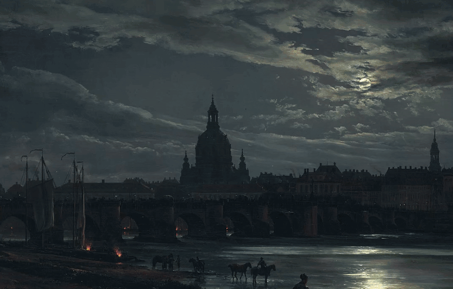

<div align="center">

# rayshot

**Скриншоты в духе Lightshot для GNOME на Wayland.**<br>
Нажмите клавишу — экран мгновенно замрёт, выделите область, добавьте пометки и нажмите Enter.

[](https://aur.archlinux.org/packages/rayshot)
[](https://github.com/paranoica/rayshot/actions/workflows/ci.yml)
[](#поддерживаемые-системы)
[](LICENSE)

[English](README.md) · **Русский**

</div>

rayshot — небольшая программа для скриншотов с пометками, написана на Rust.
Расширение GNOME Shell замораживает экран на том кадре, который был в момент
нажатия, поэтому меню, подсказки и видео попадают в снимок ровно такими, какими
были, а редактор открывается поверх картинки примерно за 40 мс. Без окна
портала и без вспышки.

- **Рисуйте:** карандаш, линия, стрелка, прямоугольник, эллипс, нумерованные метки, маркер, текст, пикселизация, размытие, пипетка.
- **Передумали — поправьте:** любую фигуру можно снова взять, сдвинуть, растянуть, перекрасить, продублировать или удалить.
- **Копируйте текст:** `Ctrl+Shift+C` распознаёт выделенное через Tesseract прямо на вашем компьютере.
- **Несколько мониторов:** выделение через несколько экранов, последнее выделение запоминается.

<div align="center">

</div>

## Установка

**Arch Linux:** `paru -S rayshot` (или `rayshot-git`). Пакет ставит программу и
расширение GNOME. GNOME подхватывает новые расширения только при входе, поэтому
выйдите из сессии, войдите снова и один раз выполните `rayshot install-hotkey Print`.

**Другие дистрибутивы:** скачайте архив со
[страницы релизов](https://github.com/paranoica/rayshot/releases). Программа
для x86_64 собрана на Debian 12 и работает с glibc 2.36 и новее. Распакуйте её
туда, где она будет лежать постоянно, выполните `gnome-extension/install.sh`,
перезайдите в сессию и запустите `./rayshot install-hotkey Print`.

**Из исходников:** `cargo build --release`, дальше те же два шага с
`./target/release/rayshot`. Копия расширения в `~/.local/share` перекрывает
установленную из пакета, поэтому перед переходом на пакет выполните
`gnome-extension/uninstall.sh`.

Для работы нужны `wl-clipboard` и драйвер Vulkan. Копирование текста
необязательно, для него нужен Tesseract с языковыми данными:
`tesseract-data-eng` и `tesseract-data-rus` в Arch, `tesseract-ocr-rus` в Debian
и Ubuntu, `tesseract-langpack-rus` в Fedora.

## Использование

| Клавиша | Инструмент | | Клавиша | Действие |
|---|---|---|---|---|
| `S` | выделение, сдвиг, размер | | `Enter` / `Ctrl+C` | копировать |
| `P` | карандаш | | `Ctrl+Shift+C` | скопировать текст |
| `L` | линия | | `Ctrl+S` | сохранить в папку изображений |
| `A` | стрелка | | `Ctrl+Shift+S` | сохранить как… |
| `R` | прямоугольник | | `Ctrl+Z` / `Ctrl+Y` | отменить / повторить |
| `E` | эллипс | | `Esc` | выйти без снимка |
| `N` | нумерованные метки | | колёсико мыши | толщина линии |
| `M` | маркер | | `1`–`9` | цвета |
| `T` | текст | | | |
| `X` / `B` | пикселизация / размытие | | | |
| `I` | пипетка, копирует `#RRGGBB` | | | |

Зажмите **Shift** во время рисования: линии пойдут с шагом 45°, прямоугольник
станет квадратом, а эллипс — кругом.

**Правка нарисованного.** Нажмите `S` и кликните по фигуре: тяните её за любое
место внутри пунктирной рамки или за круглые ручки, чтобы изменить размер. Пока
фигура выделена, цвета и колёсико меняют именно её, `Delete` её удаляет,
стрелки сдвигают, `Ctrl+D` дублирует, а `Esc` снимает выделение. Двойной клик
по тексту открывает его на правку.

**Копирование текста** сразу закрывает редактор и распознаёт выделенное в
фоне; когда текст окажется в буфере обмена, уведомление покажет первую строку.
Ваши пометки не учитываются, но размытие и пикселизация применяются заранее,
так что скрытый текст остаётся скрытым.

Шестерёнка на панели выбирает, какие инструменты и кнопки показывать; у скрытых
остаются клавиши. Цвет, толщина и этот выбор запоминаются.

**Куда попадают файлы.** При копировании временная копия остаётся в
`$XDG_RUNTIME_DIR/rayshot/` (в оперативной памяти, старше суток удаляется).
Сохранение кладёт `rayshot-ДД-ММ-ГГГГ-ЧЧ-ММ-СС.png` в папку изображений
(`XDG_PICTURES_DIR`).

<details>
<summary>Команды и переменные окружения</summary>

| Команда | |
|---|---|
| `rayshot install-hotkey [клавиша]` | назначить горячую клавишу (`Print`); до этого расширение слушает `Ctrl+Print` |
| `rayshot uninstall-hotkey` | выключить расширение и вернуть `Print` штатному скриншотеру |
| `rayshot warm [on\|off\|status]` | держать тёплый процесс редактора или нет |
| `rayshot ocr --print <png>` | вывести текст, который Tesseract видит в PNG |
| `rayshot` | режим через портал, для рабочих столов без расширения |

`RAYSHOT_NO_REMEMBER_SELECTION` не восстанавливает прошлое выделение;
`RAYSHOT_BIN` указывает расширению путь к программе.

</details>

## Скорость

На GTX 1060, GNOME 51 и двух мониторах 1080p, от нажатия клавиши:

| | медиана |
|---|---|
| Экран замер | 1.7 мс |
| Редактор на экране | 38 мс (144 мс с `rayshot warm off`) |
| Текст скопирован (`Ctrl+Shift+C`, абзац) | около 0.5 с |

В простое тёплый редактор занимает около 0.2 % одного ядра, 24 МБ собственной
памяти и 196 МБ видеопамяти; `rayshot warm off` освобождает всё это.

## Как это работает

Расширение берёт у композитора кадр, который он сейчас показывает (тем же
вызовом, что и штатный скриншотер GNOME), и кладёт его поверх всего, поэтому
клавиши и ранние клики попадают в заморозку, а не в приложения под ней. Тёплый
процесс `rayshot serve` ждёт с готовой видеокартой; его прозрачные окна
проявляются сквозь замороженную картинку только после первого кадра, поэтому
ничего не мигает. Каждый процесс обслуживает один снимок, и следующий
запускается сразу. Если процесса нет или он упал, расширение запускает новый
для этого снимка.

## Поддерживаемые системы

GNOME Shell с 45 по 51 версию на Wayland. Каждая из этих версий проходит тесты
в CI: Fedora 39, Ubuntu 24.04, Fedora 41, Debian 13, Fedora 43, Ubuntu 26.04 и
Arch. GNOME 44 и более ранние версии расширение загрузить не могут. На других рабочих столах
можно повесить клавишу на `rayshot`, и снимок пойдёт через портал, без
заморозки; этот путь не тестируется. На реальном железе проверяется NVIDIA.

## Сравнение с другими

Штатный скриншотер GNOME замораживает экран так же, но рисовать не умеет.
Flameshot и Ksnip рисуют, но в GNOME на Wayland снимают через портал, и
пользователи жалуются на окна разрешений и задержки. Ближе всего по духу
Lightshot, ShareX и CleanShot X на Windows и macOS. rayshot никуда ничего не
загружает. Полные таблицы с источниками — в [docs/comparison.ru.md](docs/comparison.ru.md).

## Как это проверяется

142 юнит-теста в Rust и пять наборов для расширения. Soak-тест гоняет GNOME
Shell без экрана с настоящим rayshot: 100 тёплых и 20 холодных снимков и 16
сценариев (падения, отключение мониторов, сон, блокировка, сбой копирования,
OCR) — и падает при утечке. CI гоняет укороченный soak на каждой версии GNOME
из списка выше.

```sh
gnome-extension/tests/soak.sh 100 20
```

## Если что-то не так

| Что происходит | Что делать |
|---|---|
| После установки или обновления клавиша ничего не делает | выйдите из сессии и войдите снова: GNOME на Wayland не умеет перезагружать расширения. |
| `Print` всё ещё открывает штатный скриншотер | один раз выполните `rayshot install-hotkey Print`. |
| «rayshot keeps failing to prepare its overlay» | посмотрите `journalctl --user -b \| grep rayshot`, затем `rayshot warm off` и `rayshot warm on`. |
| Экран замер, а редактор не появился | возможно, кончилась видеопамять; частая причина — запись экрана с буфером повтора. |
| После Enter в буфере обмена пусто | `wl-copy` не успел получить фокус; уведомление подскажет, где временная копия. |
| «Install tesseract to copy text» | установите Tesseract и языковые данные, см. [Установку](#установка). |
| После удаления пакета `Print` ничего не делает | `gsettings reset org.gnome.shell.keybindings show-screenshot-ui` |
| «rayshot was updated…» или «…do not match» | перезайдите в сессию, чтобы программа и расширение были из одного релиза. |
| «The rayshot program was not found» | установите rayshot или укажите путь к нему через `RAYSHOT_BIN`. |

## Лицензия

MIT. Подробности в [LICENSE](LICENSE).
